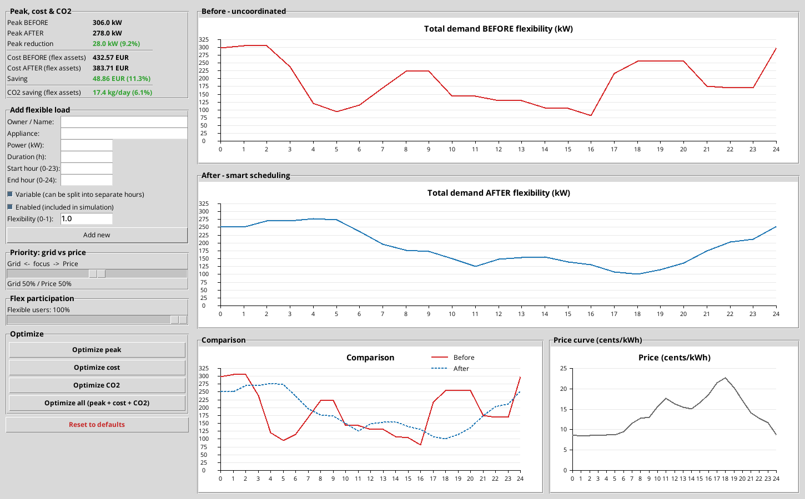
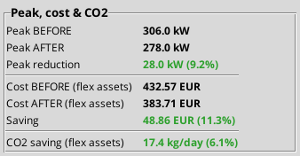
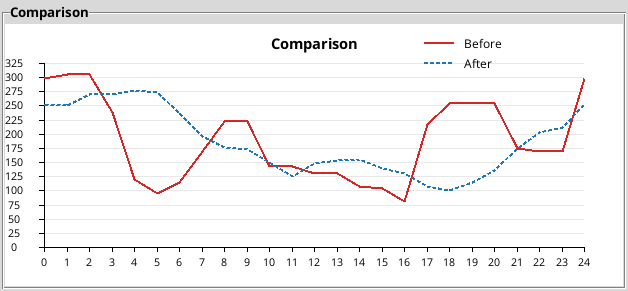
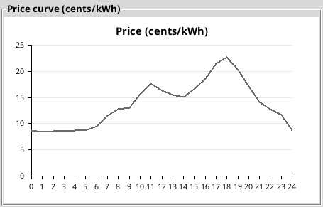

# FlexiCity

[](https://github.com/KSou799/FlexiCity/actions/workflows/tests.yml)

A 24-hour electricity load-shifting simulator. It models 24 flexible city loads, such as EV charging, heat pumps, HVAC and refrigeration, and moves the shiftable part of each one into hours with spare grid capacity and lower prices. At default settings it lowers the daily peak of the modelled city by 9.2% and the daily electricity cost of the flexible loads by 11.3%.



Built in two days at **Urban Circular Hack Helsinki 2025** (U!REKA European University hackathon), team of four. The challenge was *"how might we prepare cities for the increasing demand in electricity?"* and our angle was that a city can get a lot of headroom without building new grid, just by being smarter about *when* big loads run. I have kept developing it since the event (see [Changes since the hackathon](#changes-since-the-hackathon)).

## Results at default settings

100% participation, 50/50 grid vs price priority, 24 modelled loads:

| Metric                          | Uncoordinated | Smart schedule | Change            |
|---------------------------------|---------------|----------------|-------------------|
| Daily peak                      | 306.0 kW      | 278.0 kW       | −28.0 kW (−9.2%)  |
| Energy used 17:00 to 22:00      | 1,157 kWh     | 635 kWh        | −45.2%            |
| Evening peak, 17:00 to 22:00    | 255.0 kW      | 175.0 kW       | −80.0 kW (−31.4%) |
| Daily cost of the flexible loads| €432.57       | €383.71        | −€48.86 (−11.3%)  |
| Daily CO₂ of the flexible loads | 287.3 kg      | 269.9 kg       | −6.1%             |

These are model outputs on 24 illustrative loads, not measurements on a real city. The load sizes are scaled down, so the percentages are the result, not the kW.

In the uncoordinated case the daily peak is at 01:00 to 03:00, when the bus depot, tram depot, data-centre battery and server backup all start charging as soon as their windows open. The evening, 17:00 to 22:00, is the second hump at 255 kW. The smart schedule takes 45% of the energy out of the evening and lowers the evening hump to 175 kW. The daily peak moves to 04:00.





Red is the uncoordinated schedule, dashed blue the smart one.

## What I worked on

On the team I owned the scheduling algorithm, the four optimisers, the city load model and the data inputs.

**The city model** is 24 flexible loads: EV fleets, office HVAC pre-cooling, apartment-block heat pumps, supermarket and small-shop refrigeration, hospital laundry, tram and bus depots, data centres, metro and school ventilation, public chargers, swimming-pool water heating and sauna heaters. Each one has a rated power, a run time, a window of hours it may run in, and a flexibility factor: how much of its power can move without hurting the service.

**The scheduler** builds two schedules.

- *Uncoordinated:* every load runs its run time from its usual start, which is when its window opens, like plugging in the moment you get home. The heat pumps are the one exception: they usually start at 05:00 but may pre-heat from 02:00.
- *Smart:* the shiftable part of each load (power × participation × flexibility factor) is moved. Loads are placed largest first. For each one, every hour in its window gets a score, a weighted blend of grid load and price, each scaled 0 to 1 within the window, and the load goes into the lowest-scoring hours. After each placement the demand curve is updated, so smaller loads score against the new state and do not pile on top of each other.

Variable loads (EV charging, data-centre batteries, ventilation) can be split across separate hours. Fixed loads (oven preheating, sauna heaters, hospital laundry, fridge and freezer defrost) run in one continuous block, so for those the scheduler slides a block of the right length across the window and picks the best position. Each fixed load stands for a group of identical machines, for example several laundry machines: the share that moves runs as one block in its new hours, and the rest keeps its usual hours.

The placement is repeated, up to five rounds, until no load moves. In the first round the biggest loads choose their hours while smaller loads are still sitting in their usual hours, so they avoid hours that empty out a moment later. A second round fixes that. Every setting quoted in this README settles in two or three rounds.

**The four optimisers** each try every combination of the two sliders in 1% steps, 10,201 schedules per run, and pick the best one for their goal:

| Optimised for | Participation | Grid / price | Peak    | Cost    | CO₂    |
|---------------|---------------|--------------|---------|---------|--------|
| Peak          | 63%           | 99 / 1       | −34.9%  | +0.1%   | −8.5%  |
| Cost          | 100%          | 0 / 100      | +65.2%  | −21.6%  | −1.8%  |
| CO₂           | 99%           | 95 / 5       | −31.5%  | +1.3%   | −9.6%  |
| All three     | 65%           | 90 / 10      | −34.4%  | −0.3%   | −8.6%  |

Changes against the uncoordinated schedule. Cost and CO₂ cover the flexible loads.

Each optimiser wins on its own goal and can lose on the others. Chasing price alone moves every load into the same cheap night hours and raises the peak by 65%, which is why the scheduler weighs grid load as well as price. The combined optimiser has a guardrail I added after noticing that an equal-weighted average would happily accept a cost increase for a big peak cut: any setting where one of the three gets worse than the uncoordinated schedule is rejected.

The lowest peak comes at 63% participation, not 100%. That is a limit of the scheduler, not a reason to have fewer flexible users: leaving part of each load in its usual hours spreads it over more hours than the greedy placement does on its own. An exact solver does better at 100% (below).

**The data** is the Nord Pool day-ahead price for Finland on Monday 24 November 2025, the day the team built the prototype, recorded from the Helen website. Nord Pool sets 15-minute prices, so each hour in the model is the average of four, including 25.5% VAT. These are energy prices only, without transfer fees or electricity tax. The hourly CO₂ intensity is an illustrative profile shaped after Fingrid's emission data, not a recorded day.



In the model the cheapest hours are at night and the cleanest around midday, so cost and CO₂ pull loads in different directions.

## How good is the greedy scheduler?

The scheduler is a greedy heuristic: it places one load at a time and never goes back to try a different combination. To see what that costs, I wrote the same problem as a mixed-integer linear program (`benchmark_milp.py`, PuLP with the CBC solver) and compared the two at 100% participation:

| Target                                     | Greedy             | Best found by MILP | Nothing can beat   |
|--------------------------------------------|--------------------|--------------------|--------------------|
| Lowest peak                                | 210.0 kW (−31.4%)  | 190.8 kW (−37.6%)  | 184.6 kW (−39.7%)  |
| Lowest cost                                | €339.05 (−21.6%)   | €339.05 (−21.6%)   | €339.05 (−21.6%)   |
| Lowest peak at the default cost (€383.71)  | 278.0 kW (−9.2%)   | 237.5 kW (−22.4%)  | 231.9 kW (−24.2%)  |
| Lowest cost at the default peak (278.0 kW) | €383.71 (−11.3%)   | €360.93 (−16.6%)   | €360.26 (−16.7%)   |

"Best found by MILP" is the best schedule the solver found in 60 seconds per problem, so it can differ slightly between runs. "Nothing can beat" comes from the same problem with loads allowed to run fractions of an hour, which gives a floor no real schedule can go below. The floor holds at any participation level, not only 100%: a load that moves only partly is already one of the fractional schedules the relaxed problem allows. The MILP schedules are within 4% of that floor.

At the same cost as my default schedule, a better schedule exists with a peak about 22% lower instead of 9%. At the same peak, one exists that saves about 17% instead of 11%.

The greedy scheduler finds the cheapest schedule exactly, because when only price counts each load can pick its own cheapest hours without affecting the others. For the peak it is noticeably worse, because peak depends on how all the loads fit together.

## What the model leaves out

- One day only, treated as repeating. A load whose window runs past midnight puts its early-morning hours into hours 0 to 7 of the same day.
- The uncoordinated schedule starts every load when its window opens. Every load with a midnight window therefore starts at 00:00, which is what creates the night peak. Real metered data would give a fairer baseline.
- Each load runs at constant power. When only part of a load moves, the moved part runs in the new hours and the rest in the usual hours, so a fixed load acts as a group of identical machines, not as one machine. It is a scheduling exercise on top of mechanical equipment, not a heat-transfer simulation, so I assume shifting a load inside its window does not break thermal or operational limits.
- A fixed load with a 00:00 to 24:00 window cannot run a block across midnight (for example 22:00 to 02:00), although the day is otherwise treated as repeating.
- Street lighting "early dimming" is modelled as a 10 kW load to schedule. Dimming is really a reduction, so this one is a simplification.
- Prices are one recorded day, not a live feed. It was an expensive day, more than twice the November average, so the euro savings are larger than on a typical day. The percentages are the result.
- The CO₂ profile is illustrative, so the CO₂ results show the method, not a measured saving.
- One shared grid connection, no distribution network or substation limits.
- The hour score scales load and price to 0 to 1 within each load's window, so it compares how much better an hour is, not by how many kW or cents.

## What I'd build next

- Live price and CO₂ feeds (Nord Pool, Fingrid).
- A multi-day horizon so EV state of charge and heat-pump pre-heating carry across days.
- The MILP solver inside the app, not only as a benchmark.
- Distribution-network modelling so the peak relief lands at the right substation.
- Forecast uncertainty. The current schedule assumes everything runs exactly as planned, which it will not.

## Run it

Python 3 with `tkinter` (bundled with most installs). The app needs no other packages.

```bash
python Flexi_City.py
```

Drag the two sliders, click any of the four optimiser buttons, or add your own load through the form on the left.

Tests, no extra packages needed (the checks against the exact solver run only when PuLP is installed):

```bash
python -m unittest -v
```

Benchmark against the exact solver (takes a few minutes):

```bash
pip install "pulp>=2.7,<3"
python benchmark_milp.py
```

## Files

| File                       | What it is                                                     |
|----------------------------|----------------------------------------------------------------|
| `flexicity_model.py`       | The model: loads, prices, CO₂, scheduler and optimisers. No GUI |
| `Flexi_City.py`            | The tkinter app built on the model                             |
| `test_flexicity_model.py`  | Tests for the scheduler rules and the numbers in this README   |
| `benchmark_milp.py`        | Exact MILP solution of the same problem, compared with the greedy scheduler |

## Changes since the hackathon

The code was first uploaded to GitHub on 1 March 2026, so the commit history starts then, not at the hackathon in November 2025.

- Split the model out of the GUI into `flexicity_model.py`, so it can be tested and benchmarked without opening a window. The optimisers now call the model directly instead of moving the sliders 10,201 times.
- The scheduler repeats the placement until no load moves, up to five rounds.
- Heat pumps may pre-heat from 02:00. Before, their window was exactly as long as their run time, so they could never move and their flexibility factor did nothing.
- Added tests and the MILP benchmark.
- CO₂ is now reported on the same basis as cost, the flexible loads only, in both the stats panel and the optimiser results. The app no longer extrapolates one modelled day to tonnes per year.
- Peak is labelled in kW instead of "units".
- The busy cursor during an optimiser run used a Windows-only name, which crashed the optimisers on macOS and Linux. Fixed.
- October 2026: the README gives the price date and basis and labels the CO₂ profile as illustrative, describes fixed loads as groups of machines, and reports the evening peak. The tests check the greedy results against the exact solver's floor. The price chart scales to the highest and lowest price instead of cutting off at 0 and 25 c/kWh, and the app's before panel is labelled "uncoordinated" as in this README.

## Hackathon details

Urban Circular Hack Helsinki 2025 (U!REKA European University hackathon), HXRC Arabia Campus, 24 to 25 November 2025. Partners: Metropolia UAS, City of Helsinki, City of Espoo, City of Vantaa, Helsinki-Uusimaa Regional Council.

**Team 7:** Sou Komiya, Robert Winiarczyk, Dimitrios Pontikakis Batana, Ailikuti Tayier.

## Why it matters

Peak electricity consumption in Espoo rose 46% from January 2023 to January 2024, and Caruna expects peak power needs in its Espoo grid area to rise 179% from 2020 to 2030 (source: City of Espoo). Building more grid is slow and expensive. Shifting flexible loads in time is a cheaper lever, and many large city loads do not need to run *right now*: an EV plugged in at 18:00 just needs to be full by morning, a defrost cycle does not care whether it runs at 19:00 or 03:00, and a data-centre backup battery can charge whenever the grid has room.

## Sources

- *Towards Climate-Neutral Espoo 2030*, Elina Wanne, City of Espoo (peak power figures from Caruna).
- *Energy Solutions as part of Strategic Urban Planning*, Alpo Tani, City of Helsinki.
- Nord Pool day-ahead prices, Finland, 24 November 2025, via the Helen website.
- CO₂ intensity: illustrative hourly profile shaped after Fingrid's emission data.

[MIT license](LICENSE).
